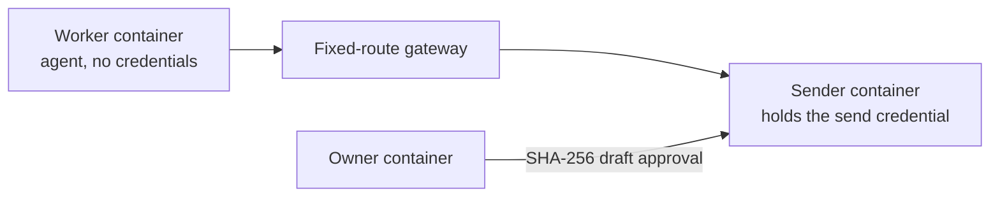

# send-lock plugin + container wall + a repeatable test that proves the wall

[](https://github.com/percyhendrux123-prog/send-lock-kit/actions/workflows/ci.yml)

> **Part of the seat**, a collection of Hermes plugins that work together: watch, decide, act, prove, hand off. This one covers **act**: it refuses sends by default. [See the whole collection](https://github.com/percyhendrux123-prog#the-seat-a-collection-of-hermes-plugins).

An experiment in keeping a Hermes agent from sending things it should not.
Repository: https://github.com/percyhendrux123-prog/send-lock-kit

```sh
git clone https://github.com/percyhendrux123-prog/send-lock-kit
cd send-lock-kit
```

## At a glance



| Phase | Blocked by plugin | Passed plugin, blocked by wall | Outside effects |
|---|---|---|---|
| 1: plugin + wall | 32 / 46 | 14 / 46 | 0 |
| 2: wall only | n/a (plugin off) | 46 / 46 | 0 |

It has three parts:

1. **send-lock plugin** (`plugins/send-lock/`): a default-deny pre-tool policy.
   It refuses unknown tools, known send commands and edits to its own config,
   and tells the agent why in plain words.
2. **Container wall** (`deploy/one_door/`): the agent runs in a container whose
   only network route is a fixed-route gateway. The send credential lives in a
   separate sender container. The sender only sends a draft that carries an
   approval recorded by a separate owner container, matched by SHA-256 of the exact draft.
3. **Wall test** (`deploy/one_door/test_worker_in_wall.sh`): a real Hermes runs
   inside the wall, driven by a scripted fake model, and is made to attempt 46
   send, publish, exfiltrate and tamper actions. The verdict comes from
   observers outside the worker (a tripwire host, a fake receiver, the sender
   journal), never from what the agent says.

## What the test showed, and what it did not

- **The plugin alone is not a containment boundary.** In the test, 14 of the 46
  attack cases passed the plugin and were stopped only by the wall. The other 32 were
  stopped by the plugin. The harness reports this as `LOCK ... PARTIAL`.
- With the plugin switched off, the wall alone stopped all 46. Both phases
  recorded 0 outside effects. Each phase ran 50 cases: the 46 attack cases, 3
  harmless controls and 1 positive control for a permitted route.
- The approval flow behaved as designed: no approval means hold, the agent
  cannot approve its own draft, a changed draft is refused, a replay is refused.
- The newest two runs' verdict files are in `docs/evidence/` (`verdict.txt`,
  `verdict.json`, `smoke/verdict.txt`). Other run files were left out of this copy.

Limits, stated plainly:

- Everything ran on **fake services only**. No real mail, chat, account or
  provider was involved.
- The model was a **scripted fake model**. It makes exactly the listed tool
  calls. It proves nothing about how a real model behaves, improvises or can be
  talked into something.
- Hermes ran with its own approval prompts off (`--yolo`), so they could not
  hide a gap. That means the test does not show how a default install behaves.
- Requests that the wall permits can still carry data (model requests carry
  prompts; a GET carries data in its URL). See `docs/THREAT-LIST.md`.
- It was run on one Hermes image and one Docker engine (Colima). The files that
  recorded their versions were left out of this copy.
- The harness's own logic is tested offline (`tests/test_worker_in_wall.py`).
  That tests the harness, not the wall.

## Run the offline tests

Python 3.11+, standard library only. No Docker, network, install or account.

```sh
for t in tests/test_*.py; do python3 "$t" || echo "FAILED: $t"; done
bash -n deploy/*.sh deploy/one_door/*.sh demo/*.sh
```

Each `tests/test_*.py` also runs on its own. `bash demo/verify.sh direct-shell`
runs all suites plus shell syntax checks in one go.

## Install the plugin

The plugin is `plugins/send-lock/` (manifest `plugin.yaml`, entry point
`__init__.py`, registers one `pre_tool_call` hook). Its own README has the
details and a disclosure of what it reads and writes. From a checkout:

```sh
hermes plugins validate plugins/send-lock
cp -r plugins/send-lock ~/.hermes/plugins/send-lock
hermes plugins enable send-lock
```

The plugin is a default-deny hook: with no owner config (step 0) it allows only a
short list: read-only tools, `ls`/`pwd`/`whoami`, a plain `curl` GET and fixture
file writes. Everything else is blocked. Start a new chat session after enabling it.
It is a friendly first layer. It is not a containment boundary by itself.

## Run the wall test

Needs Docker with Compose v2 on a throwaway Linux VM (Colima on macOS), about
10 GB of free disk, and roughly 10 minutes plus first-time image pulls. The
script creates its own Colima profile, refuses to start if any other
container or VM is running, pulls two public images pinned by digest (the only
network use), and removes everything at the end.

```sh
bash deploy/one_door/test_worker_in_wall.sh preflight      # checks only, changes nothing
set -o pipefail
WIW_APPROVED_RUN=yes WIW_PULL_APPROVED=yes \
WIW_BASE_IMAGE='python@sha256:<digest>' \
WIW_HERMES_IMAGE='nousresearch/hermes-agent@sha256:<digest>' \
  bash deploy/one_door/test_worker_in_wall.sh all 2>&1 | tee /tmp/wiw-run.txt
```

Evidence is written to `docs/evidence/worker-in-wall-<stamp>/`. Success prints
`worker-in-wall: PASS (fake services only)`. Design, limits and the full case
list: [docs/WORKER-IN-WALL-PLAN.md](docs/WORKER-IN-WALL-PLAN.md). Operator
runbook: [docs/ONE-DOOR.md](docs/ONE-DOOR.md). Threats and known limits:
[docs/THREAT-LIST.md](docs/THREAT-LIST.md).

## Other parts of the repository

The owner-agent kit these pieces came from (rundown, ClickUp helper, numbers
routine, VPS bootstrap) is described in [docs/OWNER-KIT.md](docs/OWNER-KIT.md).
